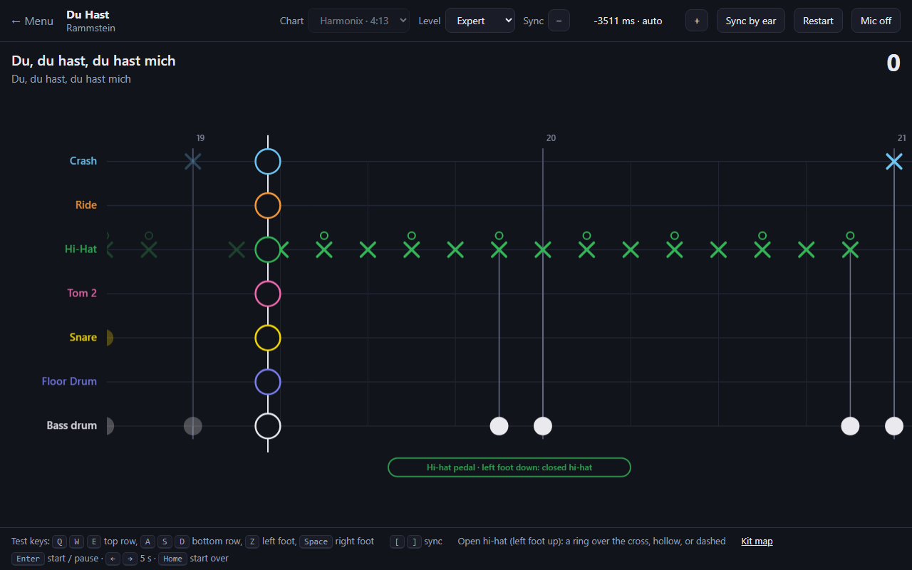
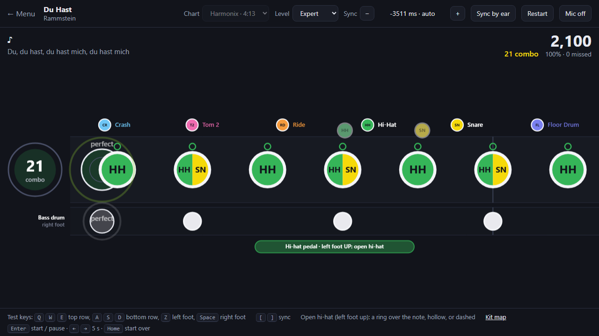
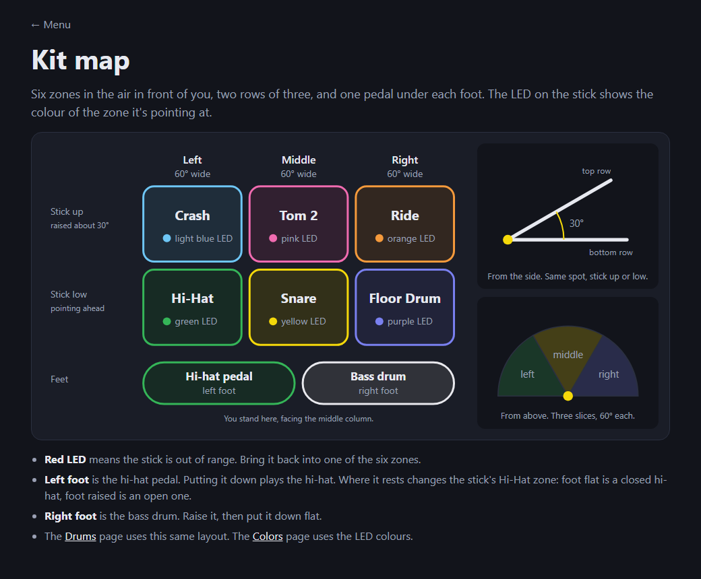

# Air Drums

Play the real drum part of the song Spotify is playing, on the Fresh 'n Rebel
Air Drums (1AAD100). A static site: no server, no build step.

Live: https://1vogada.github.io/airdrums/

Try it without Spotify: https://1vogada.github.io/airdrums/?demo=everlong%20foo%20fighters&at=40#/colors

## What it does

- **Follows Spotify.** It asks Spotify what is playing and how far in you are,
  every two seconds, so the notes follow a pause, a seek or a skip.
- **Loads the real drum part.** For each song it looks up a community drum
  chart on [Chorus Encore](https://www.enchor.us) (the Clone Hero chart search
  engine) and maps it onto the kit: six stick zones and two foot pedals.
- **Shows lyrics** in time, from [LRCLIB](https://lrclib.net).
- **Scores your hits by microphone.** The sticks only talk to the speaker, so
  the site listens for the drum sounds.



Four pages, same notes:

- **Tab** (the main one): the drum part written out like a tab. One line per
  drum, bars and beats, scrolling under a play line. A cross is a cymbal, a
  dot is a drum, a small ring over a hi-hat cross means open.
- **Drums**: the kit laid out like the manual's picture. A ring closes in on
  the drum to hit.
- **Colors**: six lanes in the sticks' LED colours. Notes fall and you hit
  them on the line. The bass drum is the wide bar.
- **Taiko**: one track, like a taiko game. Notes ride in from the right and
  you hit them on the circle. Each note has its drum's colour and short name
  (HH, SN, CR...); drums hit together share one note, split in their colours.
  The bass drum has its own thin track underneath. A note you hit flies up to
  its drum's name, so the colours teach themselves.



Eight things to hit, seven instruments (the hi-hat is a stick zone and a pedal).
The site's [kit map](https://1vogada.github.io/airdrums/#/map) shows where each one is:



| Zone | LED colour | Chart lane |
|---|---|---|
| Crash | light blue | green cymbal |
| Tom 2 | pink | yellow or blue tom |
| Ride | orange | blue cymbal |
| Hi-Hat | green | yellow cymbal |
| Snare | yellow | red |
| Floor Drum | purple | green tom |
| Bass drum (right foot) | (white here) | kick |
| Hi-hat pedal (left foot) | (green here) | open / closed hi-hat, where the chart says |

The left foot is the hi-hat pedal: flat makes the sticks' hi-hat closed, raised
makes it open, and putting it down plays the hi-hat cymbal.

### Which drum a note really is

A chart's lanes are a game's simplification. An open hi-hat is often written on
the "ride" lane, and a fast hi-hat run on the snare lane so two hands can play
it. Rock Band's own charts (charter "Harmonix") also carry the notes that drive
the on-screen drummer: what is hit on a real kit, and when the hi-hat is open.
Where a chart has those, the site goes by them and prefers that chart:

- every hit lands on the drum it really is;
- an open hi-hat has a small ring over it (Tab, Taiko), is hollow (Colors) or
  dashed (Drums), and the left foot pad says up or down.

Other charts fall back to the lanes (table above). `tests/inspect_chart.mjs`
shows what each chart of a song says, section by section.

## Setup

Open **Setup** on the site.

1. **Spotify.** Spotify limits hobby apps to a few users, so the site uses
   your own free app. At [developer.spotify.com/dashboard](https://developer.spotify.com/dashboard)
   open your app, add the redirect URI the setup page shows
   (`https://1vogada.github.io/airdrums/`), and paste the app's client ID into
   the site. Login is PKCE: no client secret, and the tokens stay in your browser.
2. **Microphone.** Turn it on and set the line so only your hits go over it.
   Music from the same speaker also reaches the mic: keep it quieter than the
   drums, or play the music on headphones.
3. **Teach it your drums** (optional). Hit each drum four times. After that
   it also checks you hit the right drum, not only the timing.

## Getting the notes in time

A chart is timed to its own copy of the song, which can start earlier or later
than Spotify's, and a Bluetooth speaker adds its own delay.

- **Auto.** The chart knows when each line is sung and so do the lyrics: the
  gap between them is how far apart the two copies are (game charts often
  start 2 to 5 seconds late). Good to about 0.2 s, since lyric timings are
  hand-made. Charts without vocals can't be lined up this way and show
  "not synced".
- **By ear, all the time.** With the mic on, the site keeps comparing the last
  12 seconds of sound with the chart and tightens the line-up to within a few
  milliseconds. The mic hears the song as you do, late by whatever the speaker
  and Bluetooth add, so this is the line-up that matches your ears. By itself
  it only makes small corrections (0.12 s a step, 0.15 s in all): a drum
  pattern repeats, and a bigger jump could land the notes a beat off.
- **Sync by ear** (the button) searches wider, for when the notes are far off.
  What it finds is also remembered as how late your setup's sound usually is,
  and new songs start from there.
- **−** and **+** (or `[` and `]`, with Shift for bigger steps) nudge by hand.

The tuning sits on top of the automatic line-up and is remembered per song and
chart. Click the number to drop it and go back to automatic.

### How good are the charts?

Measured against 30-second clips of the real recordings (`tests/agree_check.mjs`):
once a chart is lined up, 88 to 100% of its bass drum and snare hits sit on a
real hit in the recording, for seven of eight songs tried. The notes are
right; what goes wrong is the line-up. Two things to know:

- A game's version of a song is sometimes a different edit than Spotify's. One
  line-up then fits one part of the song and is off in another (seen on
  Chop Suey!: about a second, part way through).
- The lyric line-up is good to about 0.2 s, which is a lot in a drum part.
  That is what the mic is for.

## Limits

- Chart coverage is best for rock and metal; plenty of pop and hip-hop has no
  drum chart. The site says so when it finds none.
- Charts are community-made. The **Chart** menu switches between versions;
  ones marked "simple" don't tell cymbals from toms.
- The mic can tell that you hit and roughly which drum, not which stick.
- Restart needs Spotify Premium.

## Next

- Left foot: teach the mic the open hi-hat and the pedal "chick" as their own
  sounds, and score them. Only Rock Band's own charts say when the hi-hat is
  open.
- Line-up: for a chart without vocals, borrow the line-up of another chart of
  the same song by matching their drum patterns.
- Mic: the line-up by ear is tested with real recordings played in as the
  microphone (`tests/ear_check.mjs`, `tests/ear_e2e.mjs`), not yet with a real
  microphone in a room. Scoring is only tested with a fake microphone.
- Songs whose chart is a different edit: re-line-up section by section.
- Songs with no chart: fall back to a generated beat.

## Where the data comes from

The site hosts no charts, audio or lyrics. Each browser fetches what it needs:

- Chart search: `api.enchor.us`. Notes: only the `notes.chart` / `notes.mid`
  entry of the chart's `.sng` package is read from `files.enchor.us`, with
  HTTP range requests. The audio in the package is never downloaded.
- Lyrics: `lrclib.net`.
- Playback state: the Spotify Web API.

## Development

```bash
node dev/serve.mjs
```

Then open http://127.0.0.1:8377/ (Spotify wants `127.0.0.1`, not `localhost`;
add `http://127.0.0.1:8377/` as a second redirect URI to log in locally).

```bash
node tests/charts_check.mjs
```

finds and parses real charts for a handful of songs. `tests/mic_check.html`
reports what the mic code hears (a browser's fake microphone works).

The tests below compare charts with the real recordings. They need `ffmpeg`
and fetch Deezer's public 30-second preview clips (the site itself never does):

| Test | What it shows |
|---|---|
| `tests/agree_check.mjs` | how many of a chart's bass and snare hits are in the recording |
| `tests/align_check.mjs` | where each clip sits in its chart, next to what the lyrics say |
| `tests/ear_check.mjs` | the line-up by ear: clips played through the real mic code, started from a wrong guess |
| `tests/ear_passage.mjs` | how well each stretch of one clip can be placed |
| `tests/ear_e2e.mjs` | the same in a real browser (Edge, dev server running), the clip played in as the microphone |
| `tests/inspect_chart.mjs`, `inspect_sync.mjs`, `inspect_open.mjs` | what the charts of one song say |

| File | What it holds |
|---|---|
| `js/kit.js` | the zones, their colours and test keys |
| `js/charts.js` | chart search, fetching the notes file, lyric-based alignment |
| `js/chartparse.js` | `.chart` and `.mid` parsers |
| `js/align.js` | finding where a stretch of sound sits in a chart |
| `js/spotify.js` | login, now playing, the follow clock |
| `js/lyrics.js` | LRCLIB |
| `js/mic.js`, `js/onset-worklet.js` | hit detection, drum fingerprints, the sound kept for the line-up |
| `js/game.js` | judging and score |
| `js/render.js` | the four game pages |
| `js/main.js` | menu, pages, setup |
| `sw.js` | makes browsers check for new files on every load, so an update never runs half old |
